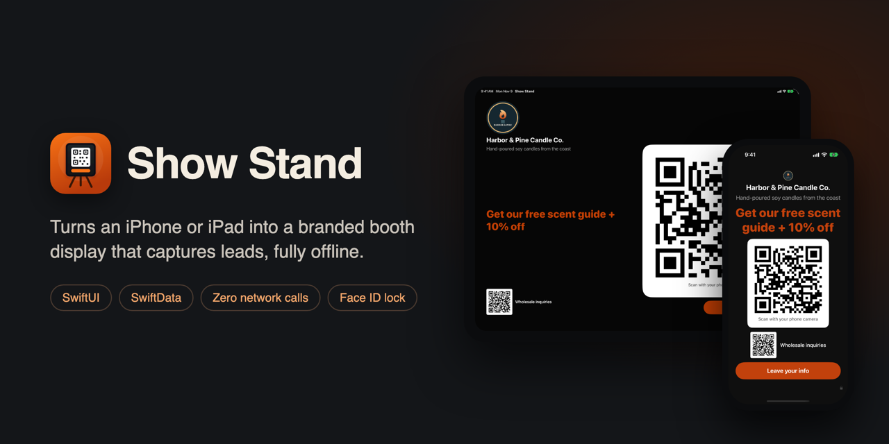
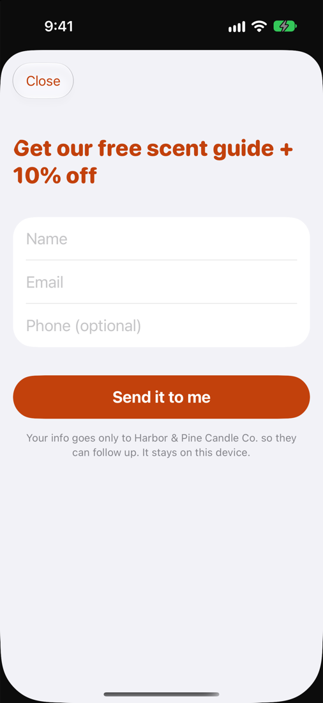
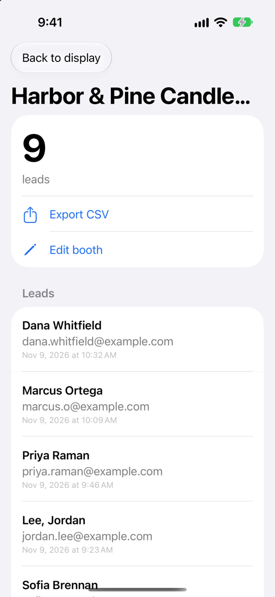
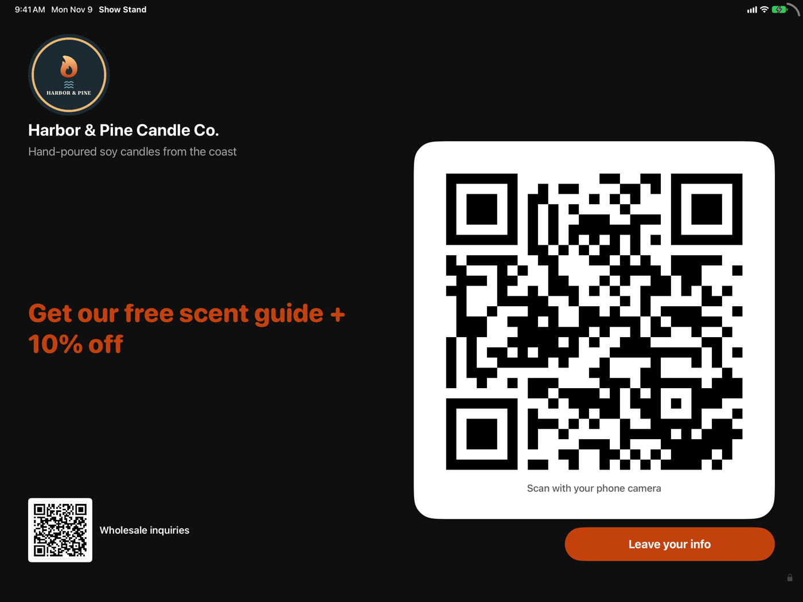
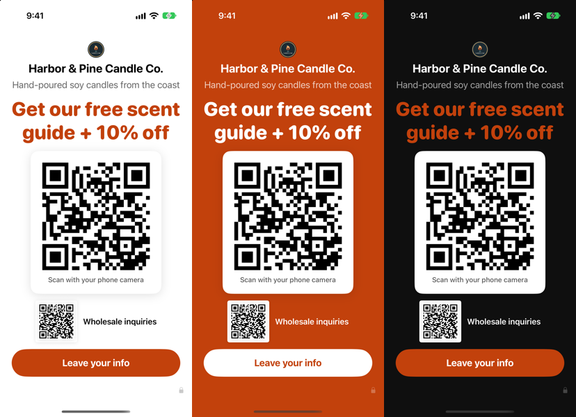

# Show Stand



Show Stand turns an iPhone or iPad into a branded display for a vendor booth. Visitors scan a QR code or tap **Leave your info**, and their details stay on the device. There are no accounts or servers, and the app makes **zero network calls**.

I built it for small vendors at markets, conferences and pop-ups. It goes from a fresh install to a live booth screen in about a minute, so they can set it up before the doors open.

## Screens

| Booth display | Visitor form | Vendor area (Face ID) |
|---|---|---|
|  |  |  |

On iPad, or in landscape, the brand and offer sit on the left and the QR on the right:



There are three themes (Clean, Bold, Dark), and the accent colour is picked up from the logo:



*Harbor & Pine Candle Co. is a made-up business. The names and example.com addresses in the screenshots are made up too.*

## What it does

- **Four-step setup:** logo and name, business type, link, then the offer. The offer suggestions come with a one-line reason for each and change with the business type.
- **Booth display:** a large QR code that scans from about 3 ft, plus an optional second QR (for example "Wholesale inquiries"). The QR can be moved and resized, and the app shows a live estimate of how far away it will scan. The layout shifts slowly to prevent OLED burn-in, and the screen stays awake.
- **Visitor form:** name, email and optional phone. The form clears itself after a minute of inactivity, and it never suggests anything from earlier visitors.
- **Vendor area:** opens with Face ID, Touch ID or the device passcode, and locks again when the app goes to the background or sits idle. It has a lead list, swipe to delete, CSV export (which handles commas, quotes and newlines correctly) and booth editing.
- **Private by design:** SwiftData storage only. There are no analytics or third-party SDKs, and the app works in airplane mode.

## Try the demo

The repo includes a fictional example booth with nine sample leads.

1. Open `ShowStand.xcodeproj` in Xcode.
2. Pick the **ShowStand Demo** scheme and an iPhone or iPad simulator, then Run.

The demo scheme passes `-demo`, which replaces any saved booth with the example. It has extra launch arguments that are off by default:

| Argument | Effect |
|---|---|
| `-demoForm` | Opens the visitor form (Debug builds only) |
| `-demoVendor` | Opens the vendor area without Face ID (Debug builds only) |
| `-demoTheme clean` / `bold` / `dark` | Picks the theme (dark is the default) |
| `-demoLandscape` | Locks the booth to landscape |

The screenshots above came from these arguments with `xcrun simctl`, for example:

```bash
xcrun simctl launch booted is.perry.showstand -demo -demoVendor
```

The **ShowStand** scheme runs the real first-launch setup.

## Tech

Swift and SwiftUI, with SwiftData for storage. It targets iOS and iPadOS 17 and later as one universal app. QR codes come from Core Image (`CIQRCodeGenerator`), the vendor lock uses LocalAuthentication, and CSV export goes through `ShareLink`. There are no third-party dependencies.

The build spec is in [CLAUDE.md](CLAUDE.md). It covers scope, out-of-scope items and the acceptance tests run on a real iPhone and iPad Pro.

## How it was built

I wrote the spec, scope limits and acceptance tests, and AI coding agents (Claude Code) wrote the code. I then tested it on real devices against those acceptance tests.
